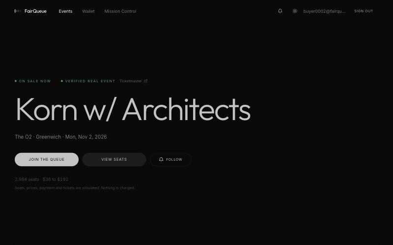
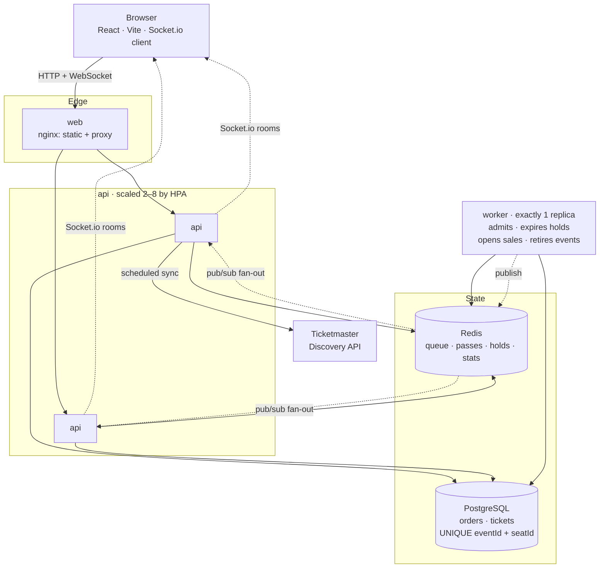
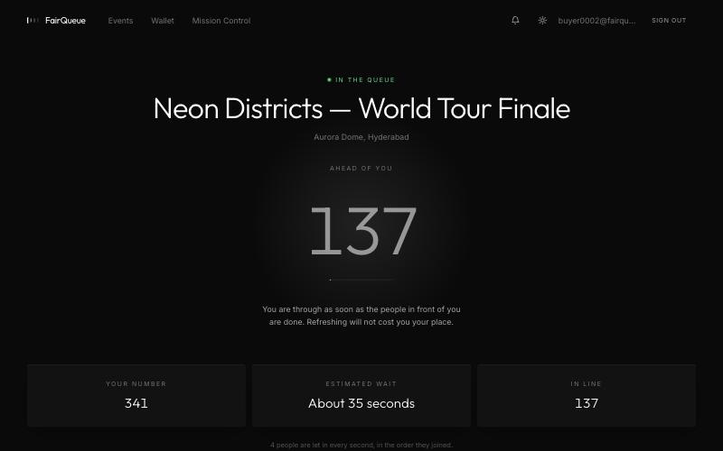
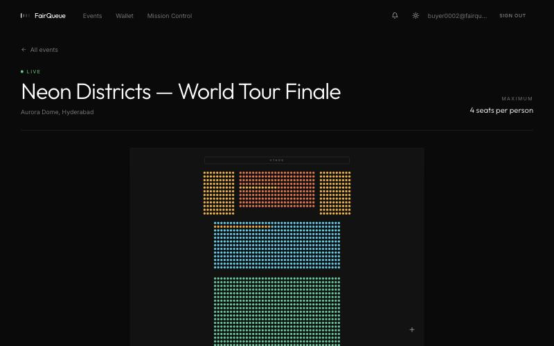
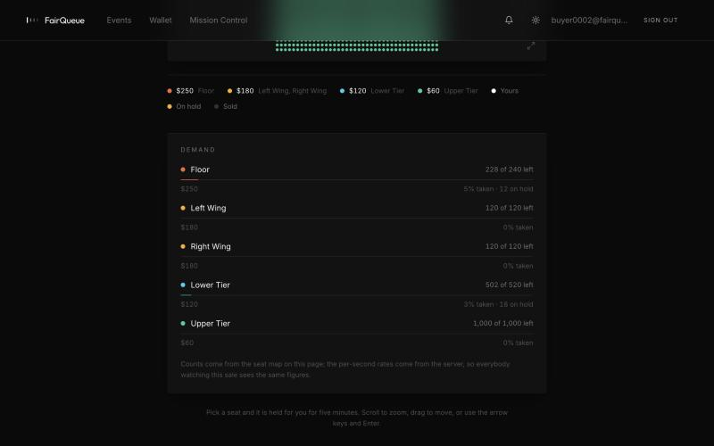
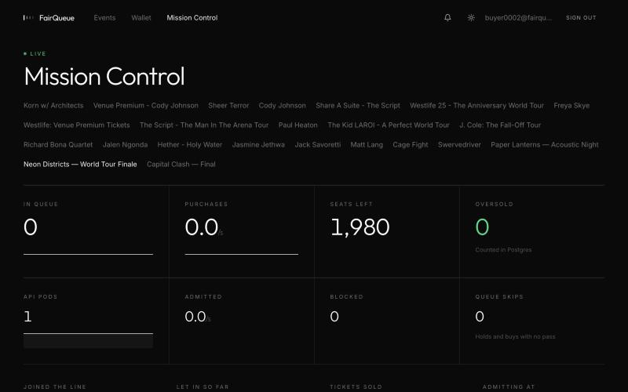
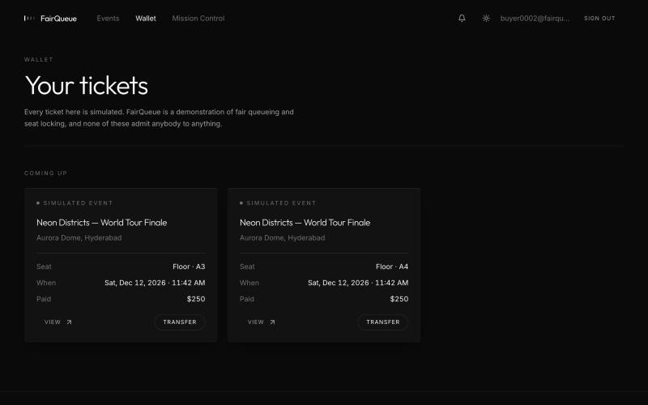

# FairQueue

A flash-sale ticketing platform that holds its shape under load: buyers are
served in the order they arrived, a seat is never sold twice, and a bot cannot
skip the line. The claim is not asserted — it is measured, against a
deliberately broken build of the same system, and every number in
[RESULTS.md](RESULTS.md) is read from a benchmark output file.



---

## Overview

When tickets for a popular event go on sale, three things reliably go wrong.
The site falls over under the arrival spike. The same seat gets sold to two
people, because checking whether a seat is free and then taking it are two
separate operations and a thousand buyers are racing between them. And whoever
refreshes fastest — usually a script — wins.

FairQueue addresses each one directly:

- **A waiting room instead of a scramble.** Everyone takes a numbered place in
  a Redis sorted set and is admitted in join order at a controlled rate. The
  surge hits the queue, not the database.
- **Atomic seat holds.** Checking and claiming happen inside a single Lua
  script, so they cannot come apart. A multi-seat request is all-or-nothing.
- **Admission passes.** Holding and buying both require a pass issued by the
  queue, so there is nothing useful for a bot to call until it has waited its
  turn.
- **A database constraint underneath all of it.** `UNIQUE(eventId, seatId)`
  means that if every lock above somehow failed, the write fails instead of
  the seat selling twice.

The api holds no state of its own, which is what lets Kubernetes run many
copies of it. Everything shared lives in Redis (fast, temporary) or PostgreSQL
(permanent). A single worker process — never more than one — moves the queue
forward, expires holds and retires finished events.

Real upcoming events are pulled from the Ticketmaster Discovery API and
labelled as verified, with a link to the source. **All ticket inventory,
pricing and payment are simulated**; no real ticket is ever issued.

---

## Features

| | |
|---|---|
| **Fair queueing** | Redis sorted set, idempotent join, admission in strict join order at a configurable rate |
| **Live waiting room** | One broadcast per event per second serves every waiting browser; reconnecting never costs a place |
| **Atomic seat holds** | Lua check-and-claim, all-or-nothing across multiple seats, five-minute expiry with a worker sweep |
| **Live seat map** | 2,000-seat SVG venue with zoom, pan, keyboard navigation and batched updates four times a second |
| **Demand map** | Per-section fill and live claim rates, counts derived from client seat state, rates computed server-side |
| **Ticket wallet** | Ownership as a first-class column, atomic transfers under a conditional update, append-only audit trail |
| **Event radar** | Follow events; the worker opens sales on time and notifies followers over a per-user socket room |
| **Mission Control** | Live queue depth, purchase rate, pod count and an oversold counter read from PostgreSQL |
| **Bot resistance** | Pass requirement plus per-account rate limiting; measured at 0% of tickets won by bots |
| **Authentication** | Google OIDC with PKCE, ten-minute access tokens, rotating refresh tokens with reuse detection |

---

## System architecture



The worker never talks to a browser. It publishes on a Redis channel, every
api pod subscribes, and each forwards to the browsers connected to it — which
is what lets one broadcast reach every waiting user regardless of which pod
they landed on.

### Booking workflow

1. **Join.** `POST /queue/join` runs a Lua script that hands out a join number,
   or returns the one you already hold. Joining twice is impossible, so a
   refresh or a dropped connection never costs a place.
2. **Wait.** The worker moves an `admitted` watermark forward by `admitPerSec`
   each second and issues a 10-minute pass to everyone in the gap. It
   broadcasts one number; each browser computes `myNumber − admitted` itself.
3. **Hold.** `POST /holds` runs a Lua script that verifies the pass, checks
   every requested seat, and only then claims them all. The hold is a Redis key
   with a TTL plus an entry in a sorted set scored by expiry — the key is the
   lock, the sorted set is how the worker finds what to release.
4. **Buy.** Checkout re-verifies the holds, then writes the order and tickets
   in one PostgreSQL transaction. Only after that does Redis mark the seats
   sold, which drops the holds and greys them out on every open seat map.
5. **Expire.** Each second the worker releases holds whose five minutes are up
   and broadcasts the seats as available again.

---

## Tech stack

| Layer | Technology |
|---|---|
| Frontend | React 18, Vite, TypeScript, Tailwind, Framer Motion, Recharts, Socket.io client |
| API | Node, Express, TypeScript, Socket.io with the Redis adapter, Prisma, Zod |
| Worker | Node, TypeScript — one replica, by design |
| Data | PostgreSQL 17, Redis 8 |
| Infrastructure | Docker, Kubernetes on k3d, plain YAML, HPA on CPU |
| Testing | Vitest (157 tests), k6 |

### Decisions worth explaining

**Why a queue rather than a bigger database.** Contention is the problem, not
throughput. Ten thousand people trying to buy the same two thousand seats will
collide regardless of how fast the write path is. The queue converts a
simultaneous crowd into a sequence, and the sequence is fair because it is
ordered by arrival.

**Why Lua for seat holds.** Holding seats is check-then-claim, and any gap
between the two is a double sale. Redis runs a script start to finish with
nothing interleaved, so the check and the claim cannot come apart — and a
four-seat request either gets all four or leaves nothing behind.

**Why one broadcast instead of one message per user.** Each browser already
knows its own join number, so `admitted` is all it needs to compute its
position. One message per event per second serves ten waiting users or ten
thousand identically.

**Why a UNIQUE constraint as well.** Every lock above it is application logic,
and application logic has bugs. The constraint is the one guarantee that does
not depend on the code being correct: if everything else fails, the insert
fails instead of the seat selling twice.

**Why exactly one worker.** It is the only process allowed to move the queue
forward. A second copy would hand out the same admission passes twice, so the
deployment pins it to one replica with a `Recreate` strategy — a rollout must
never briefly run two.

---

## Performance benchmarks

Measured with `make bench`, which runs each workload against both builds from an
identical starting state and verifies the outcome in PostgreSQL afterwards.
`naive` is the same application with the queue, the holds and the unique index
removed. Full detail and methodology in [RESULTS.md](RESULTS.md).

**Machine:** Apple M4, 10 cores, 16 GB · PostgreSQL 17.11 · Redis 8.10.3 ·
Node v26.8.2 · k6 v2.3.0

### Data consistency

Counted in PostgreSQL after each run with `GROUP BY "seatId" HAVING COUNT(*) > 1`.

| Workload | naive oversold | FairQueue oversold |
|---|---|---|
| hot-seats (1,200 attempts at 50 seats) | 41 | **0** |
| flash-sale (200 VUs over 70s) | 16 | **0** |
| bots (10% skip the queue) | 6 | **0** |
| breaking-point (50 → 550 req/s) | 1 | **0** |

### Checkout latency

p95 of the checkout endpoint alone. A whole-run comparison would be misleading,
since FairQueue buyers also join and poll a queue and so have a different
request mix by design; checkout is the same endpoint doing the same database
work in both builds.

| Workload | naive p95 | FairQueue p95 | Change |
|---|---|---|---|
| flash-sale | 25.3 ms | 5.9 ms | 77% faster |
| bots | 26.8 ms | 7.7 ms | 71% faster |
| breaking-point | 25.5 ms | 7.0 ms | 73% faster |
| hot-seats | 51.8 ms | 47.0 ms | 9% faster |

### Bot resistance

| Build | Tickets won by bots | Share of sale |
|---|---|---|
| naive | 263 of 1,985 | 13.2% |
| FairQueue | 0 of 540 | **0.0%** |

### Concurrency

Both builds sustained **550 req/s**, the top of the tested ramp, without the
error rate rising. Neither broke, so that figure is a floor rather than a
measured ceiling — locating the real limit needs a longer ramp.

### Not measured

Kubernetes autoscaling. The manifests, HPA and `bench/scale-test.sh` are
written and reviewed but have never run against a live cluster, because the
development machine has no container runtime. No autoscaling figure is claimed
anywhere, and none will appear until `bench/results/scale-test.json` exists.
See [k8s/README.md](k8s/README.md).

---

## Screenshots

| Waiting room | Seat map |
|---|---|
|  |  |

| Section demand | Mission Control |
|---|---|
|  |  |

| Ticket wallet |
|---|
|  |

---

## Getting started

### Prerequisites

- Node 20 or newer
- PostgreSQL 16 or newer and Redis 7 or newer, running locally — or Docker
- [k6](https://k6.io) for the benchmarks
- Docker and [k3d](https://k3d.io) for the Kubernetes deployment

### Setup

```bash
git clone https://github.com/YasodharGubba05/FairQueue.git
cd FairQueue
cp .env.example .env

make install        # dependencies for web, api and worker
make services-up    # Postgres and Redis as Homebrew services
make db-create
make migrate
make seed           # 3 events, one with 2,000 seats, plus 2,000 test buyers
```

Then run the three processes in separate terminals:

```bash
make dev-api        # :4000
make dev-worker
make dev-web        # :5173
```

Or run the whole stack in Docker:

```bash
make compose-up
```

### Signing in

| Account | Password |
|---|---|
| `admin@fairqueue.dev` | `admin123` |
| `buyer0001@fairqueue.dev` … `buyer2000@fairqueue.dev` | `password123` |

### Optional: live events

FairQueue runs entirely on its seeded catalogue with no credentials. To pull
real upcoming events, add a free
[Ticketmaster Discovery](https://developer.ticketmaster.com) key to `.env` and
run `make sync-events`.

Google sign-in is likewise optional; without `GOOGLE_CLIENT_ID` the button is
hidden and password login is unaffected.

### Commands

| Command | What it does |
|---|---|
| `make test` | The full test suite |
| `make typecheck` | TypeScript across web, api and worker |
| `make bench` | Every workload against both builds, then regenerates RESULTS.md |
| `make bench-one SCENARIO=hot-seats MODE=naive` | A single benchmark run |
| `make sync-events` | Fetch live events now |
| `make up` | k3d cluster, build images, deploy — unverified, see `k8s/README.md` |
| `make down` | Tear everything down |

---

## Project layout

```
api/      Express API, Socket.io, Prisma, Lua scripts, 157 tests
worker/   The single process that admits, expires, opens and retires
web/      React frontend
k8s/      Plain Kubernetes manifests and the HPA
bench/    k6 workloads, the orchestrator and RESULTS.md generation
```

---

FairQueue is a portfolio project. Payment is simulated, no real tickets are
sold, and demonstration tickets admit nobody to any event.
